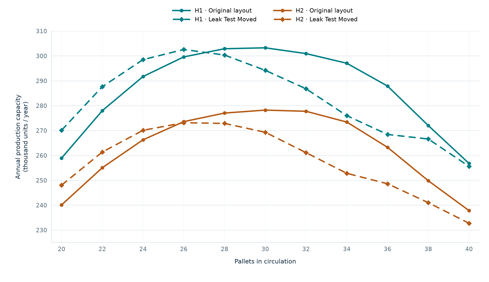

# Industrial Simulation Portfolio

**Eduardo Pinto · Production capacity, material flow and scenario analysis**

Industrial simulation studies developed in **WITNESS 26**, with Excel used to organise process inputs and compare results. The work presented here covers model development, data preparation, experiment design and analysis of operational alternatives.

The aim is to support decisions about how a production system should operate: how much it can produce, how many pallets should circulate and what changes when a station or an operating assumption is altered.

## Featured Case Study

### Pallet Sizing and Layout Comparison for an Assembly Line

Two layouts, two equipment availability assumptions and eleven pallet quantities were compared. The highest reported capacity occurred with **30 pallets in the original layout** and **26 with the leak test station relocated**.

The alternative used four fewer pallets at its peak, with estimated annual output **0.22% lower under H1** and **1.82% lower under H2**. The study supported a pallet recommendation for either layout; the relocation decision remained with the company.

[Read the case study: problem, method, results and recommendation](projects/capacidade-linha-montagem.md)

## Operational Questions

| Question | Analysis presented |
|---|---|
| How much can the line produce? | Capacity under defined layout and availability assumptions |
| How many pallets should circulate? | Output across a range of pallet quantities, including behaviour near the maximum |
| What changes when a station is relocated? | Comparison at equal pallet quantities and at each layout's highest output |
| How does availability affect the decision? | Sensitivity of capacity and pallet recommendations to operating assumptions |

## Work Demonstrated

| Area | Work covered |
|---|---|
| Model development | Representation of processing operations, routes and pallet progression rules in WITNESS |
| Input preparation | Organisation of operation parameters, availability assumptions and routes in Excel |
| Experiment design | Structured comparison of layouts, availability scenarios and pallet quantities |
| Result analysis | Capacity charts, scenario tables, sensitivity calculations and conditional recommendations |

The case includes the reported results, their operational interpretation and the limits of the available evidence. A [CSV dataset](data/capacity-scenarios.csv) and [figure reproduction instructions](scripts/README.md) accompany the charts.

---

**Publication status:** Local working draft. Numerical results still reflect the source study. A public demonstration requires replacement data and corresponding model executions before release.
