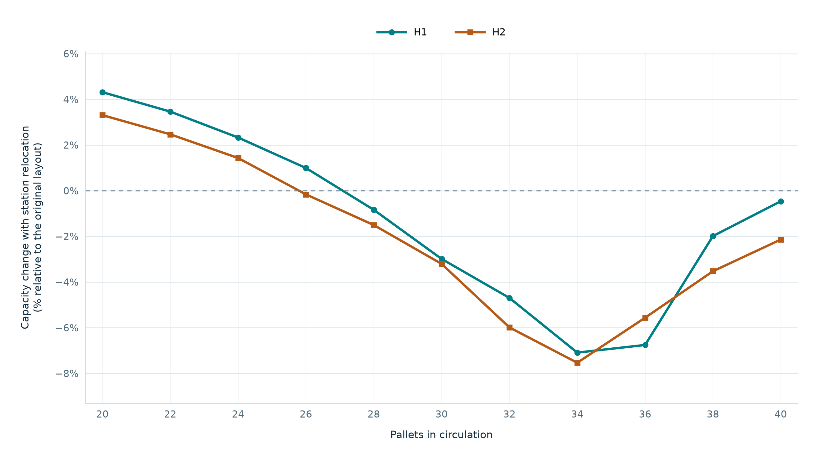

# Pallet Sizing and Layout Comparison for an Assembly Line

**Selecting a circulating pallet quantity when layout and equipment availability change.**

An assembly-line capacity study was developed in **WITNESS 26** to support two linked decisions: how many pallets should circulate, and how the recommendation changes if the leak test station is relocated.

The highest reported output occurred with **30 pallets in the original layout** and **26 in the relocated layout**, under both availability assumptions. Relocation changed the preferred pallet quantity without increasing peak production. The layout choice was left to the company to weigh its operational and implementation considerations.

| Study at a glance | Scope |
|---|---|
| Work covered | Model development, input preparation, experiment design and execution, and analysis |
| Tools | WITNESS 26 and Excel |
| Comparison | Two layouts × two availability assumptions × eleven pallet quantities |
| Measure | Projected annual production capacity, in units/year |
| Decision supported | Pallet sizing for either layout option |

> Working draft for GitHub. Figures currently use source-study results and require a synthetic demonstration before public release. Charts were reconstructed from stored results; the WITNESS experiments were not rerun for this portfolio draft.

[Problem](#the-operational-problem) · [Method](#model-and-experiment-design) · [Results](#capacity-results) · [Sensitivity](#how-sensitive-is-the-pallet-recommendation) · [Recommendation](#recommendation-and-business-interpretation) · [Evidence](#evidence-and-reproducibility)

## The Operational Problem

Pallets carry units through the production route and remain occupied during processing. A station may be ready but lack an incoming unit; alternatively, it may complete an operation and be unable to release its pallet because the next position is occupied. These conditions are known as starvation and blocking, respectively.

Pallet quantity affects both the supply of work and the occupancy of circulation positions. Increasing the quantity can improve feeding, but the same processing and movement resources must accommodate the additional pallets. The study examined this relationship for the existing route and a route associated with relocation of the leak test station.

A dynamic model was appropriate because the decision depends on interactions over time. Individual processing times alone do not reproduce the sequence of waiting, processing and release conditions that determines completed output.

## Model and Experiment Design

Operation data, availability parameters and routes were organised in Excel and imported into WITNESS. The model represented processing stages and pallet progression through occupancy and sequencing rules. The alternative changed route connections and associated flow rules.

| Model element | Purpose in the study |
|---|---|
| Processing operations | Represent the work required at each stage |
| Routes and circulation positions | Represent connections and the space available for progression |
| Occupancy and sequencing rules | Determine when a pallet can advance |
| Availability parameters | Examine capacity under different operating assumptions |
| Circulating pallet quantity | Test the relationship between the pallet fleet and completed output |

Pallet quantity was varied from **20 to 40 in steps of two**, producing 44 reported capacity values across the four scenarios.

| Availability scenario | Automated equipment | Manual operations |
|---|---:|---:|
| H1 — higher availability | 98% | 99.5% |
| H2 — lower availability | 95% | 99% |

Availability describes the ability to operate; utilisation describes how an operation was used. An available station can still wait for work or downstream space. Both automated and manual availability change between H1 and H2, so this comparison does not isolate their individual contributions.

Each layout was compared within the same labelled availability scenario. The basis for the selected availability percentages, the pallet search range and its two-pallet increment is not documented in the available material. The range brackets all four reported peaks, but intermediate quantities were not evaluated in this comparison.

## Capacity Results

*Figure 1. Projected annual capacity versus circulating pallets. Colour identifies availability; line style and marker identify layout. Markers represent reported values and connecting lines guide the eye.*

The capacity estimates below are expressed in **units/year**, rounded to the nearest unit. Each curve rises to a maximum and then declines. H2 produces less than H1 throughout the tested range.

| Layout | Availability | Pallets at highest capacity | Annual capacity, units/year |
|---|---|---:|---:|
| Original | H1 | 30 | 303,254 |
| Leak Test Moved | H1 | 26 | 302,580 |
| Original | H2 | 30 | 278,219 |
| Leak Test Moved | H2 | 26 | 273,148 |

For a fixed layout and availability scenario, let **C(n)** be capacity with **n** pallets. The selection rule is:

**Highest tested capacity = max{C(20), C(22), …, C(40)}**

The recommendation is the tested pallet quantity associated with that maximum. The decline after the peak shows that adding pallets reduced output in these results. Determining the mechanism requires matching blocking, waiting and circulation indicators to the runs.

## Comparing the Layouts

### Each Layout at Its Own Highest Output

This comparison allows each layout to use its preferred tested pallet quantity. Peak capacity change is measured relative to the original layout:

**Peak capacity change (%) = (relocated peak / original peak − 1) × 100**

| Availability | Original peak, units/year | Relocated peak, units/year | Peak change | Annual output difference, units |
|---|---:|---:|---:|---:|
| H1 | 303,254 | 302,580 | -0.22% | 674 |
| H2 | 278,219 | 273,148 | -1.82% | 5,071 |

The output difference is the original peak minus the relocated peak, calculated from unrounded values. At those peaks, the pallet fleet changes by:

**Pallet fleet reduction (%) = [(30 − 26) / 30] × 100 = 13.3%**

Four fewer pallets were associated with the alternative's maximum. Their economic value depends on pallet and relocation costs; the capacity difference must be assessed against required production.

### Both Layouts at the Same Pallet Quantity

Holding pallet quantity fixed answers a different question: how do the reported capacities compare without resizing the fleet?

*Figure 2. Relocated-layout capacity relative to the original layout at equal pallet quantity and labelled availability.*

**Capacity change (%) = [C_relocated(n) / C_original(n) − 1] × 100**

Positive values favour the relocated layout; negative values favour the original. The alternative produces more at 20, 22 and 24 pallets in both scenarios. At 26, the difference is **+0.99% under H1** and **−0.16% under H2**; from 28 onwards, it produces less in both.

Relocation therefore has no uniform capacity advantage across the tested quantities. Layout and pallet quantity must be assessed together.

## How Sensitive Is the Pallet Recommendation?

The size of the difference around a maximum matters as well as its location. The following table compares neighbouring tested quantities with the best result for their own layout and availability scenario:

**Shortfall from peak (%) = [1 − C(n) / C_peak] × 100**

| Layout | Pallets | Shortfall under H1 | Shortfall under H2 |
|---|---:|---:|---:|
| Original layout | 28 | 0.12% | 0.43% |
| Original layout | 30 | 0.00% | 0.00% |
| Original layout | 32 | 0.77% | 0.17% |
| Leak Test Moved | 24 | 1.35% | 1.12% |
| Leak Test Moved | 26 | 0.00% | 0.00% |
| Leak Test Moved | 28 | 0.74% | 0.10% |

For the original layout, 28 pallets have shortfalls of approximately **0.12% under H1** and **0.43% under H2**. For the relocated layout, 28 pallets have a shortfall of approximately **0.10% under H2**.

These small differences show why locating a numerical maximum is only the first step in selecting an operating setting. The stated recommendations remain 30 and 26; acceptable capacity loss and run variability would be needed to establish a broader operating range or justify a different quantity.

## Projecting Production After Losses

The workbook applies a calendar conversion and a unit loss adjustment to the reference production:

**Projected production after losses = reference production × (target shifts / reference shifts) × (1 − unit loss rate)**

For this study:

**Projected production after losses = reference production × (18/15) × 0.985**

The ratio converts from 15 to 18 shifts. The factor 0.985 retains 98.5% of projected units after a 1.5% loss. Applying the same positive multiplier to every scenario preserves the ranking of capacities and the location of their maxima.

This is proportional calendar scaling. If additional shifts affect maintenance, start-up conditions or resources, those effects require an explicit simulation scenario. The loss factor adjusts output but does not model the cause of the losses. Although the workbook outputs are identified as annual capacity, the mapping from the experiment measurement window to the reference annual basis still requires confirmation.

## Recommendation and Business Interpretation

The recommendation presented to the company was to use **30 pallets if the original layout is retained**, or **26 if the leak test station is relocated**. The company was left to choose the layout according to its own reasons. Implementation and subsequent production performance are not established in the material reviewed here.

To judge whether either option meets a production requirement, with both quantities expressed in the same units:

**Capacity margin = projected annual capacity − required annual production**

The production requirement and an acceptable margin are not established here, so the analysis cannot determine whether the output differences are operationally immaterial. Relocation costs, pallet costs, space, maintenance access and disruption would also be needed for an investment comparison.

## Evidence and Reproducibility

| Evidence available | What it supports |
|---|---|
| Textual model definitions | Presence of process, route, occupancy and sequencing logic |
| Labelled result tables | Reconstruction of the four curves and identification of their reported maxima |
| Confirmed calculation factors | Interpretation of the shift projection and unit loss adjustment |
| Accompanying dataset and Python script | Reproduction of the figures and derived percentage comparisons |

Full model validation against the physical process is not documented in the reviewed material. Saved input links and stored availability values are not fully consistent; the mapping between loaded scenarios, saved experiments and reported results remains a verification task. Graph reproduction does not resolve that model-level issue.

Run duration, time units, warm-up application, initial conditions and calendar normalisation also require confirmation for the displayed series. Replications and confidence intervals are not established. Where runs contain randomness, repeatability should be assessed; for deterministic runs, the stability of results with respect to initial conditions and measurement horizon should be checked.

The conclusions identify the highest reported outputs **within the tested range**, rather than a proven global optimum. A public demonstration should use coherent synthetic inputs, corresponding WITNESS executions and a record of the configuration behind each result.

[Explore the 44 capacity values](../data/capacity-scenarios.csv) · [Reproduce the figures](../scripts/README.md)

---

[Back to the portfolio](../README.md)
