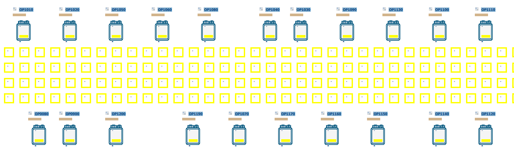
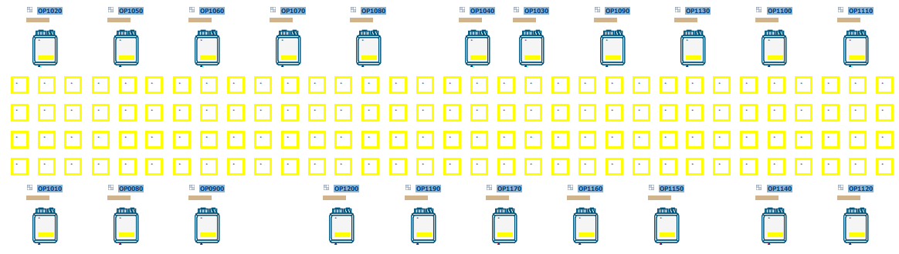
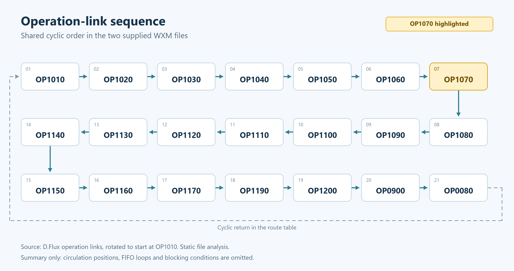
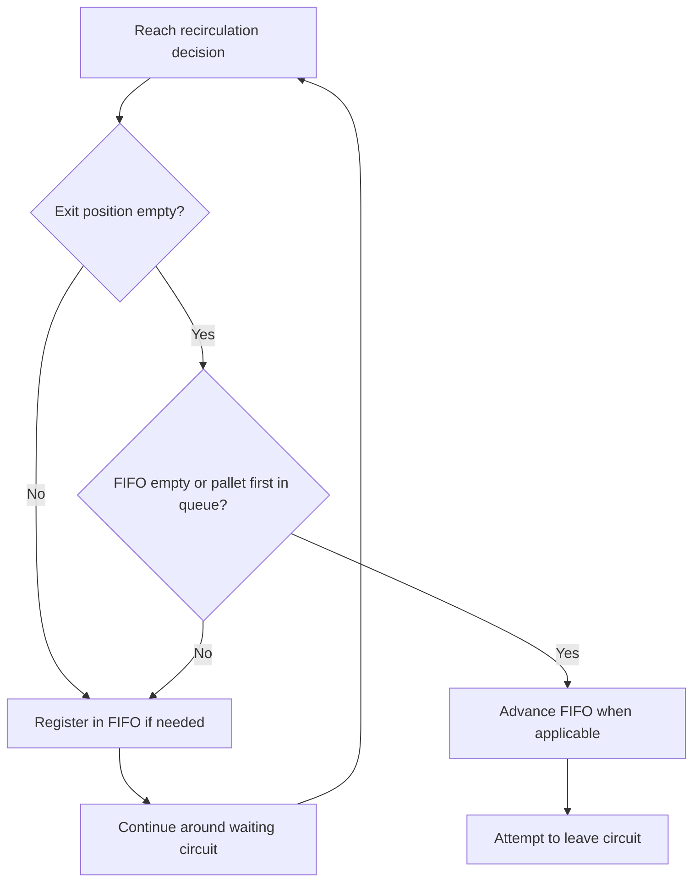
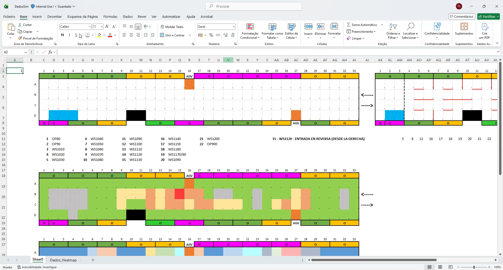

# Pallet Sizing and Layout Comparison for a Matrix Assembly Line

**Selecting a circulating pallet quantity when layout and equipment availability change.**

An assembly-line capacity study was developed in **WITNESS 26** to support two linked decisions: how many pallets should circulate, and how the recommendation changes when OP1070 is relocated. The system combines a matrix of transport positions with separate processing stations and controlled recirculation.

The highest reported output occurred with **30 pallets in the original layout** and **26 in the alternative layout**, under both availability assumptions. The alternative reached its highest tested output with four fewer pallets, while its peak production was lower. The study supported pallet sizing for either layout; the company retained the layout decision.

| Study at a glance | Scope |
|---|---|
| Work covered | Model development, input preparation, experiment design and execution, and analysis |
| Tools | WITNESS 26, Excel and Python for figure reproduction |
| Comparison | Two layouts × two availability assumptions × eleven pallet quantities |
| System | Assembly line with a matrix transport system and controlled recirculation |
| Main measure | Projected annual production capacity, in units/year |
| Decision supported | Pallet sizing for either layout option |

Company information in this case is shared with permission. The capacity charts were reconstructed from stored study results. Subsequent static analysis of the supplied XML models and workbook confirmed the route-table correspondence and clarified the programmed circulation logic. The WITNESS experiments were not rerun for this portfolio edition.

[Problem](#the-operational-problem) · [Layouts](#model-layouts) · [Routing logic](#how-the-matrix-transport-model-works) · [Method](#model-and-experiment-design) · [Results](#capacity-results) · [Sensitivity](#how-sensitive-is-the-pallet-recommendation) · [Recommendation](#recommendation-and-business-interpretation) · [Evidence](#evidence-and-reproducibility)

## The Operational Problem

Pallets carry units through the production route and remain occupied during processing. A station may be ready but lack an incoming unit; alternatively, it may complete an operation and be unable to release its pallet because the next position is occupied. These conditions are known as starvation and blocking, respectively.

Pallet quantity affects both the supply of work and the occupancy of circulation positions. Increasing the quantity can improve feeding, but the same processing and movement resources must accommodate the additional pallets. The study examined this relationship for the existing route and the alternative arrangement associated with relocation of OP1070.

A dynamic model was appropriate because the decision depends on interactions over time. Processing times alone do not reproduce the sequence of movement, waiting, processing and release conditions that determines completed output.

## Model Layouts

The following screenshots show the two WITNESS model arrangements supplied for this case. They illustrate the model layout and are not dimensioned plant drawings.

### Original Layout

*Original arrangement. OP1070 appears in the lower row between OP1190 and OP1170.*

### Alternative Layout

*Alternative arrangement. OP1070 appears in the upper row between OP1060 and OP1080. Several other displayed station positions are adjusted as part of the arrangement.*

### Shared Operation-Link Sequence

*The stored route tables contain the same 21 operation links in the same cyclic order. The alternative sequence is rotated to start at OP1010 for comparison. The diagram omits intermediate circulation positions, repeated visits and waiting loops. It summarises operation order rather than physical geometry.*

In the supplied XML files, OP1070 is associated with **MESA position 316** in the original and **position 11** in the alternative. The operation's cycle input rule refers to the corresponding position in each file.

[View the extracted operation-link mapping](../assets/operation-link-sequence.csv)

## How the Matrix Transport Model Works

The model separates **circulating pallets**, **transport positions** and **processing operations**. A route table defines the progression through positions. Occupancy conditions and a logical FIFO list determine when a pallet can leave a waiting circuit.

The workbook's **Flux** sheet matches the stored route table in the original XML model. **Flux_2** matches the alternative. The four route fields were compared after normalising empty selector cells and numeric segment identifiers; the active route data matched in both cases.

### Route Table Fields

| Excel column | Saved field | Role in the programmed logic |
|---|---|---|
| A | Table | Identifier of the MESA position visited at this route step |
| B | Tcy | Selector between two configured movement-duration classes |
| C | Link | Operation associated with the current position |
| D | ruta | Current recirculation segment or a BN/FIN decision marker |

Column B contains a selector: a value of **2** selects the second duration argument of the model's TP function; other values select the first. The code is not itself a literal duration. The physical meaning and validity of the duration classes require separate confirmation.

Each circulating Part carries three attributes:

| Attribute | Purpose |
|---|---|
| Etape | Current logical row in the route table |
| Ruta | Current circulation segment |
| Indice | Identifier used by the FIFO logic |

The logical route row and the position identifier are different. A position can occur at several route rows when a pallet returns to the same physical location.

### Recirculation and FIFO Priority

A numeric entry in column D selects the current segment. Markers such as **1_BN** and **1_FIN** identify that segment's decision rows. These labels are conventions of this model.

At a decision point, the programmed logic checks the MESA position immediately after the segment's FIN row:

1. If the exit position is empty and the logical queue is empty, the pallet can attempt to leave the circuit.
2. If the exit is occupied, the model registers the pallet in **DT_FIFO** and directs it around the circuit.
3. If a queue already exists, a pallet can attempt to leave only when the exit is empty and its identifier is first in that queue.
4. A pallet that cannot leave continues circulating. The FIFO record preserves its priority for a later pass.

DT_FIFO stores the order of waiting identifiers. The pallets physically occupy transport positions while circulating. The table is not an additional physical buffer.

For example, in **Flux**, worksheet rows 26 and 70 refer to position **121** and carry markers **1_BN** and **1_FIN**. The next row, 71, identifies exit position **21**. At the decision, the code checks MESA(21) and FIFO priority to select departure or another circuit. The repeated position 121 has two logical roles in the route.

### Retention During Processing

The operation linked in column C represents processing separately from circulation. In the general position-release branch, a pallet can advance past a linked operation only when the operation contains no Part. Operation input rules also refer to the associated MESA position.

The model therefore distinguishes **circulating while waiting for access** from **remaining at a processing position**. Congestion at operations can propagate back to the loop's exit position and keep other pallets circulating. Additional position-specific occupancy checks govern some shared paths and crossings.

This section explains the configured logic found in the XML files. Runtime event ordering, behaviour under congestion and absence of deadlocks remain matters for execution-based verification.

## Model and Experiment Design

Operation data, availability parameters and routes were organised in Excel and imported into WITNESS. The model represented processing stages and pallet progression through occupancy and sequencing rules. The alternative changed circulation data and the position references used by operations.

| Model element | Purpose in the study |
|---|---|
| Processing operations | Represent the work required at each stage |
| Routes and circulation positions | Represent connections and space available for progression |
| Occupancy and sequencing rules | Determine when a pallet can advance |
| Logical FIFO records | Preserve priority at recirculation decisions |
| Availability parameters | Examine capacity under different operating assumptions |
| Circulating pallet quantity | Test the relationship between the pallet fleet and completed output |

Pallet quantity was varied from **20 to 40 in steps of two**, producing 44 reported capacity values across the four scenarios.

| Availability scenario | Automated equipment | Manual operations |
|---|---:|---:|
| H1 — higher availability | 98% | 99.5% |
| H2 — lower availability | 95% | 99% |

Availability describes the ability to operate; utilisation describes how an operation was used. An available station can still wait for work or downstream space. Both automated and manual availability change between H1 and H2, so this comparison does not isolate their individual contributions.

The result blocks compare layouts within the same labelled availability scenario. However, the two supplied saved XML files also contain different operating-parameter values. Their saved states alone do not establish matched operating conditions for the historical runs. The mapping between loaded data, experiments and result blocks remains a verification task.

The basis for the chosen availability percentages, pallet search range and two-pallet increment is not established in the material reviewed. The range brackets all four reported peaks, but intermediate quantities were not evaluated in this comparison.

## Capacity Results

*Figure 1. Projected annual capacity versus circulating pallets. Colour identifies availability; line style and marker identify layout. Markers represent reported values and connecting lines guide the eye.*

The capacity estimates below are expressed in **units/year**, rounded to the nearest unit. Each curve rises to a maximum and then declines. H2 produces less than H1 throughout the tested range.

| Layout | Availability | Pallets at highest capacity | Annual capacity, units/year |
|---|---|---:|---:|
| Original | H1 | 30 | 303,254 |
| Leak Test Moved | H1 | 26 | 302,580 |
| Original | H2 | 30 | 278,219 |
| Leak Test Moved | H2 | 26 | 273,148 |

For a fixed layout and availability scenario, let **C(n)** be capacity with **n** pallets. The selection rule is:

**Highest tested capacity = max{C(20), C(22), …, C(40)}**

The recommendation is the tested pallet quantity associated with that maximum. The decline after the peak shows that adding pallets reduced output in these results. Determining the mechanism behind each curve requires matching blocking, waiting and circulation indicators to the runs.

## Comparing the Layouts

### Each Layout at Its Own Highest Output

This comparison allows each layout to use its preferred tested pallet quantity. Peak capacity change is measured relative to the original layout:

**Peak capacity change (%) = (relocated peak / original peak − 1) × 100**

| Availability | Original peak, units/year | Relocated peak, units/year | Peak change | Annual output difference, units |
|---|---:|---:|---:|---:|
| H1 | 303,254 | 302,580 | -0.22% | 674 |
| H2 | 278,219 | 273,148 | -1.82% | 5,071 |

The output difference is the original peak minus the relocated peak, calculated from unrounded values. At those peaks, the pallet fleet changes by:

**Pallet fleet reduction (%) = [(30 − 26) / 30] × 100 = 13.3%**

Four fewer pallets were associated with the alternative's maximum. Their economic value depends on pallet and relocation costs; the capacity difference must be assessed against required production.

### Both Layouts at the Same Pallet Quantity

Holding pallet quantity fixed answers a different question: how do the reported capacities compare without resizing the fleet?

*Figure 2. Relocated-layout capacity relative to the original layout at equal pallet quantity and labelled availability.*

**Capacity change (%) = [C_relocated(n) / C_original(n) − 1] × 100**

Positive values favour the relocated layout; negative values favour the original. The alternative produces more at 20, 22 and 24 pallets in both scenarios. At 26, the difference is **+0.99% under H1** and **−0.16% under H2**; from 28 onwards, it produces less in both.

Relocation therefore has no uniform capacity advantage across the tested quantities. Layout and pallet quantity must be assessed together.

## How Sensitive Is the Pallet Recommendation?

The size of the difference around a maximum matters as well as its location. The following table compares neighbouring tested quantities with the best result for their own layout and availability scenario:

**Shortfall from peak (%) = [1 − C(n) / C_peak] × 100**

| Layout | Pallets | Shortfall under H1 | Shortfall under H2 |
|---|---:|---:|---:|
| Original layout | 28 | 0.12% | 0.43% |
| Original layout | 30 | 0.00% | 0.00% |
| Original layout | 32 | 0.77% | 0.17% |
| Leak Test Moved | 24 | 1.35% | 1.12% |
| Leak Test Moved | 26 | 0.00% | 0.00% |
| Leak Test Moved | 28 | 0.74% | 0.10% |

For the original layout, 28 pallets have shortfalls of approximately **0.12% under H1** and **0.43% under H2**. For the relocated layout, 28 pallets have a shortfall of approximately **0.10% under H2**.

These small differences show why locating a numerical maximum is only the first step in selecting an operating setting. The stated recommendations remain 30 and 26; acceptable capacity loss and run variability would be needed to establish a broader operating range or justify a different quantity.

## Projecting Production After Losses

The workbook applies a calendar conversion and a unit loss adjustment to the reference production:

**Projected production after losses = reference production × (target shifts / reference shifts) × (1 − unit loss rate)**

For this study:

**Projected production after losses = reference production × (18/15) × 0.985**

The ratio converts from 15 to 18 shifts. The factor 0.985 retains 98.5% of projected units after a 1.5% loss. Applying the same positive multiplier to every scenario preserves the ranking of capacities and the location of their maxima.

This is proportional calendar scaling. If additional shifts affect maintenance, start-up conditions or resources, those effects require an explicit simulation scenario. The loss factor adjusts output but does not model the cause of the losses. Although the workbook outputs are identified as annual capacity, the mapping from the experiment measurement window to the reference annual basis still requires confirmation.

## Recommendation and Business Interpretation

The recommendation presented to the company was to use **30 pallets if the original layout is retained**, or **26 if the leak test station is relocated**. The company was left to choose the layout according to its own reasons. Implementation and subsequent production performance are not established in the material reviewed here.

To judge whether either option meets a production requirement, with both quantities expressed in the same units:

**Capacity margin = projected annual capacity − required annual production**

The initial project brief identifies a target of **300,000 units**. Its planning period and the required operating margin must be confirmed on the same basis as the annual capacity estimates before making a firm service-level conclusion. Relocation costs, pallet costs, space, maintenance access and disruption would also be needed for an investment comparison.

The operational value of the study is a structured comparison of pallet quantities and layouts. A financial assessment would translate achievable changes into investment cost, annual net benefit, ROI and payback. No numerical return on investment has been established for this case.

## Development Context

Initial preparation of the position matrix and route

*Initial route-preparation image from slide 3 of the project presentation. The matrix uses rows A–D and 33 columns. The original software interface labels are retained in the screenshot.*

The initial work established a position matrix, marked the positions used at each step and organised a route table for import. This is development context rather than a screenshot of the final capacity model. The initial presentation uses WS identifiers and describes a different stage of the layout work. Its timing values have been excluded because the author identified them as incorrect. Its movement-count comparison is not used to quantify the change in the current XML models.

## Evidence and Reproducibility

| Evidence reviewed | What it supports |
|---|---|
| Original and alternative WITNESS screenshots | Displayed model arrangements and the changed position of OP1070 |
| Original and alternative XML models | Stored operation links, MESA references, position rules and FIFO logic |
| Flux and Flux_2 in the input workbook | Route data matching the corresponding stored XML tables |
| Labelled Sheet1 result blocks | The four capacity series and their reported maxima |
| Workbook calculation formulas | The 18/15 calendar projection and 0.985 unit-loss adjustment |
| Accompanying dataset and Python script | Reproduction of figures and derived percentage comparisons |
| Initial project presentation | Context for matrix preparation and the initial project brief, excluding its timing values |

The source review used **PEB-X 80k.wxm**, **PEB-X 80k_Modified.wxm**, **Calculo Estatico V2.xlsx** and **APRESENTAÇÃO.pptx**. This page presents their relevant findings and selected images; the complete native source files are not distributed by this page.

In the workbook, the original H1/H2 adjusted results occupy **Sheet1!M2:M12** and **Sheet1!U2:U12**. The alternative H1/H2 results occupy **Sheet1!M22:M32** and **Sheet1!U22:U32**. These blocks support the peak values presented above. The physical annual basis remains a separate verification item.

Full model validation against the physical process is not documented in the reviewed material. The two saved XML files contain different embedded operating parameters, and their input connections refer to a workbook filename different from the supplied V2 file. The matching route data improve traceability, but the data actually loaded for each historical experiment still need to be identified. Static analysis and graph reproduction do not resolve that execution-level question.

Run duration, time units, warm-up application, initial conditions and calendar normalisation also require confirmation for the displayed series. Replications and confidence intervals are not established. Where runs contain randomness, repeatability should be assessed; for deterministic runs, the stability of results with respect to initial conditions and measurement horizon should be checked.

The conclusions identify the highest reported outputs **within the tested range**, rather than a proven global optimum. Further verification should link each reported result to its model version, input data and execution configuration, with corresponding WITNESS runs where needed to resolve the outstanding checks.

[Explore the 44 capacity values](../data/capacity-scenarios.csv) · [Reproduce the figures](../scripts/README.md)

---

[Back to the portfolio](../README.md)
